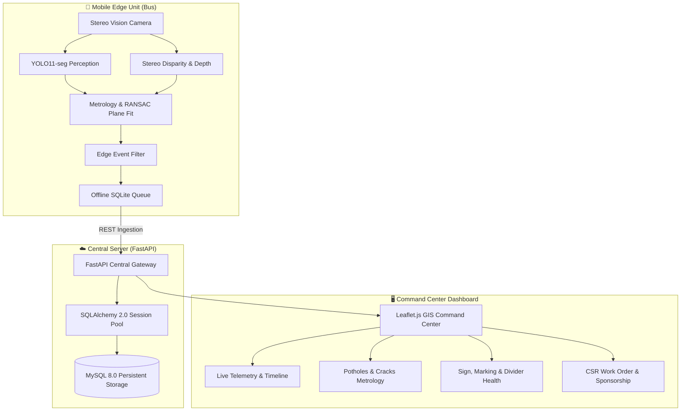

# BusSense 🚎⚡
### Mobile Sensing & Edge Intelligence Platform for Transit-Based Infrastructure Monitoring

[](https://www.python.org/downloads/)
[](https://fastapi.tiangolo.com)
[](https://www.mysql.com/)
[](https://www.sqlalchemy.org/)
[](https://pytorch.org/)
[](https://leafletjs.com/)

---

## 📌 Overview

**BusSense** turns everyday municipal transit buses into high-frequency, autonomous civic sensing units. By mounting stereo camera systems and edge computing units on public transit fleets running regular city routes (demonstrated along the *Tiruchirappalli Metro Corridor*), BusSense continuously inspects road quality, structural road defects, traffic dynamics, and civic infrastructure health without requiring dedicated survey vehicles.



---

## 🚀 Key Subsystems & Capabilities

### 1. 🛣️ Road Surface Metrology & Structural Defects
- **Metric 3D Pothole Quantification:** Uses stereo disparity fusion and RANSAC road-plane fitting to measure true metric depth (in centimeters), surface area (in m²), and excavated volume.
- **Surface Crack Networks:** Segments longitudinal, transverse, and alligator crack networks, classifying road deterioration states before catastrophic pavement failure occurs.

### 2. 🚦 Kinematic Incident & Traffic Flow Intelligence
- **Near-Miss & Hard Braking Detection:** Real-time distance and time-to-collision (TTC) tracking for lead and cut-in vehicles.
- **Hit-and-Run Incident Intelligence:** Tracks multi-vehicle trajectories, evasive maneuvers, and collision points with automated evidence clip archiving.
- **Automatic Number Plate Recognition (ANPR):** High-confidence license plate localization and OCR extraction.

### 3. 🏛️ Civic & Municipal Infrastructure Monitoring
- **Traffic Sign Condition & Legibility:** Detects regulatory, warning, and informational road signs; grades physical degradation, tilting, occlusion, and fading.
- **Pedestrian Zebra Crossing Health:** Measures zebra crossing striping wear and reflective fade percentage along transit corridors.
- **Road Divider & Median Physical Integrity:** Tracks physical elevation profiles, detecting broken kerbs, missing concrete dividers, and illegal median cuts.
- **Waterlogging & Flood Dynamics:** Detects pooling water along travel lanes and calculates flood corridor union ratios.
- **Missing Infrastructure Detection:** Identifies missing bus stop shelters, absent street lights, and damaged municipal assets against reference geospatial baselines.

### 4. 🤝 CSR Sponsorship & Municipal Work Order Portal
- Automatically converts severe road defect detections into actionable repair work orders.
- Maps corporate social responsibility (CSR) budgets to nearby infrastructure repairs with transparent cost estimation models.

### 5. 🗺️ Real-Time GIS Command Center
- Interactive Leaflet.js dashboard with live bus fleet tracking, coordinate-projected safety incidents, 24-hour event timelines, and evidence-first inspection modals.

---

## 🗄️ Database Architecture (MySQL + SQLAlchemy ORM)

BusSense uses **MySQL 8.0** as its primary persistent database engine, managed through a **SQLAlchemy 2.0** ORM layer with **PyMySQL**:

- **Connection Pooling:** Configured with `QueuePool` (`pool_size=10`, `max_overflow=20`), `pool_pre_ping=True` (active connection health checks), and `pool_recycle=3600`.
- **Session Management:** Scoped dependency injection per FastAPI request with automatic rollbacks on unhandled errors.
- **Resilient Fallback:** Seamlessly supports SQLite development fallback when MySQL environment variables are not specified.

### Core Database Entities

| Table | Primary Key | Key Attributes | Purpose |
| :--- | :--- | :--- | :--- |
| `events` | `event_id` | `bus_id`, `gps_lat`, `gps_lon`, `event_type`, `severity`, `status` | Road defects, VRU incidents, ANPR detections |
| `bus_telemetry` | `telemetry_id` | `bus_id`, `timestamp`, `gps_lat`, `gps_lon`, `speed_kmh` | Continuous bus trajectory and spatial telematics |
| `bus_heartbeats` | `heartbeat_id` | `bus_id`, `timestamp`, `status`, `speed_kmh` | Edge unit connectivity and health heartbeats |
| `media_records` | `media_id` | `event_id`, `file_type`, `timestamp` | Stored visual evidence (frames, clips, crops) |
| `infrastructure_observations`| `obs_id` | `subsystem`, `timestamp`, `latitude`, `longitude` | Raw domain sensor readings (signs, dividers, etc.) |
| `infrastructure_events` | `infra_event_id` | `subsystem`, `urgency`, `latitude`, `longitude` | Aggregated civic infrastructure defect work items |
| `csr_partners` | `company_id` | `company_name`, `csr_budget_inr`, `allocated_inr` | Corporate sponsor profiles and fund allocations |
| `csr_requests` | `request_id` | `company_id`, `pothole_event_id`, `status`, `requested_amount_inr` | Road repair sponsorship proposals |
| `reference_assets` | `asset_id` | `asset_type`, `latitude`, `longitude` | Ground truth municipal asset catalog |

---

## 📂 Repository Structure

```
├── bussense_edge/                 # Edge sensing, event filtering & offline queuing
│   ├── event_filter.py            # Edge confidence filtering & deduplication
│   └── offline_queue.py           # SQLite-based store-and-forward edge buffer
├── bussense_frontend/             # Modern HTML5 / CSS3 / Leaflet.js Command Center
│   ├── css/design-system.css      # Custom dark-mode UI design system
│   ├── js/pages/                  # Page controllers (Overview, Road Health, CSR, etc.)
│   └── index.html                 # Single-page application entrypoint
├── bussense_infrastructure/       # Domain perception engines (signs, dividers, flood, etc.)
│   ├── models/                    # PyTorch model wrappers & inference architectures
│   ├── evidence_engine.py         # Evidence clipping and keyframe extraction
│   └── trichy_replay_simulator.py # Route simulation and real-world replay driver
├── bussense_server/               # Production FastAPI backend application
│   ├── app.py                     # API route declarations & static asset mounts
│   ├── database.py                # Database abstraction layer
│   ├── db_config.py               # SQLAlchemy engine, QueuePool & session factory
│   ├── models.py                  # Declarative SQLAlchemy ORM models
│   └── schemas.py                 # Pydantic contract validation schemas
├── config/                        # Infrastructure and threshold configuration YAMLs
├── demo_routes/                   # GeoJSON corridors and reference asset geometries
├── docs/                          # Architectural documentation & technical specs
├── models/                        # Pretrained model registries and metadata
├── outputs/                       # Server media, evidence frames & validation reports
├── potcrack_stereo/               # YOLO11-seg stereo disparity & pothole metrology
├── scripts/                       # Migration scripts, renderers & diagnostic tools
│   ├── migrate_sqlite_to_mysql.py # Automated ETL database migration utility
│   └── test_master_ui_integration.py # End-to-end server & UI validation suite
├── tests/                         # Full Pytest test suite (Contract & Pipeline tests)
├── .env.example                   # Environment configuration template
├── requirements.txt               # Pinned Python package dependencies
└── run_mega_master.py             # Master demonstration runner
```

---

## ⚙️ Installation & Quickstart

### 1. Prerequisites
- **Python:** 3.10, 3.11, or 3.12 (Python 3.14 compatible)
- **MySQL Server:** Version 8.0 or higher
- **Git**

### 2. Clone Repository & Setup Virtual Environment
```bash
git clone https://github.com/ThrinayC/bussense.git
cd bussense

python -m venv .venv
# On Windows:
.venv\Scripts\activate
# On Linux/macOS:
source .venv/bin/activate
```

### 3. Install Dependencies
```bash
pip install -r requirements.txt
```

### 4. Configure Database Credentials
Create a `.env` file in the project root based on `.env.example`:
```bash
cp .env.example .env
```
Edit `.env` with your local MySQL credentials:
```ini
DB_HOST=localhost
DB_PORT=3306
DB_NAME=bussense
DB_USER=root
DB_PASSWORD=your_password
```

Create the MySQL database:
```sql
CREATE DATABASE IF NOT EXISTS bussense CHARACTER SET utf8mb4 COLLATE utf8mb4_unicode_ci;
```

### 5. Migrate Existing Data (Optional)
If you have an existing SQLite snapshot you wish to import into MySQL:
```bash
python scripts/migrate_sqlite_to_mysql.py
```

### 6. Start the BusSense Server
```bash
python -m uvicorn bussense_server.app:app --host 0.0.0.0 --port 8000
```

### 7. Open the Command Center
- **GIS Command Center:** [http://localhost:8000](http://localhost:8000)
- **Interactive OpenAPI / Swagger Docs:** [http://localhost:8000/docs](http://localhost:8000/docs)
- **Server Health Check:** [http://localhost:8000/api/health](http://localhost:8000/api/health)

---

## 🧪 Verification & Testing

BusSense features extensive test coverage across API contracts, pipeline metrology, and master UI integration:

```bash
# 1. Run FastAPI REST Contract Tests (15 tests)
python -m pytest tests/test_fastapi_contract.py -v

# 2. Run Perception Metrology & Stereo Pipeline Tests (15 tests)
python -m pytest tests/test_end_to_end_pipeline.py -v

# 3. Run Master UI & Evidence Integration Tests (6/6 suites)
python scripts/test_master_ui_integration.py
```

---

## 📄 License
This project is developed for academic, civic, and municipal road safety research.
